# LSP 玩家工具箱

> LSP 服务器玩家的桌面工具箱，把「通用珍珠炮配置器」「边境炮配置器」「材料换算器」「假人搬货」和「史莱姆区块查找器」合并成了同一个应用。 \
> 计算与配置全部在本地完成，不联网、不上传。 \
> 最新版本可从 [百度网盘](https://pan.baidu.com/s/1V3FcoPrWUt3bGQZ-vHqBZg?pwd=1234) 下载（提取码 `1234`）。 😘😘😘

[English](docs/README.en.md) · [新增工具说明](ADDING_A_TOOL.md)

## 目录

- [LSP 玩家工具箱](#lsp-玩家工具箱)
  - [目录](#目录)
  - [下载](#下载)
  - [1. 快速开始](#1-快速开始)
  - [2. 珍珠炮配置器](#2-珍珠炮配置器)
    - [2.1 使用](#21-使用)
    - [2.2 设置项](#22-设置项)
  - [3. 边境炮配置器](#3-边境炮配置器)
    - [3.1 使用](#31-使用)
    - [3.2 设置项](#32-设置项)
  - [4. 材料换算器](#4-材料换算器)
    - [4.1 导入材料清单](#41-导入材料清单)
    - [4.2 搜索与排序](#42-搜索与排序)
    - [4.3 堆叠数：默认值与批量修改](#43-堆叠数默认值与批量修改)
    - [4.4 忽略材料](#44-忽略材料)
    - [4.5 换算结果](#45-换算结果)
    - [4.6 装填建议](#46-装填建议)
    - [4.7 导出 CSV](#47-导出-csv)
    - [4.8 设置项](#48-设置项)
  - [5. 假人搬货](#5-假人搬货)
    - [5.1 站点](#51-站点)
    - [5.2 生成命令](#52-生成命令)
    - [5.3 执行（可选）](#53-执行可选)
    - [5.4 运单台账](#54-运单台账)
    - [5.5 设置项](#55-设置项)
  - [6. 史莱姆区块查找器](#6-史莱姆区块查找器)
    - [6.1 使用](#61-使用)
    - [6.2 地图与结果](#62-地图与结果)
    - [6.3 大范围与性能](#63-大范围与性能)
    - [6.4 设置项](#64-设置项)
  - [7. 设置](#7-设置)
  - [8. 数据与存储](#8-数据与存储)
  - [9. 计算说明与已知限制](#9-计算说明与已知限制)
  - [随应用附赠的小工具](#随应用附赠的小工具)
  - [技术栈](#技术栈)
  - [License](#license)

---

## 下载

最新版本放在百度网盘：

| 项目 | 内容 |
|---|---|
| 当前版本 | **v1.3.0** |
| 下载链接 | <https://pan.baidu.com/s/1V3FcoPrWUt3bGQZ-vHqBZg?pwd=1234> |
| 提取码 | `1234` |

---

## 1. 快速开始

解压下载的压缩包，双击 `LSP_PlayerKit.exe` 即可运行，不需要安装 Python 或 Node。

界面分三块：

- **左侧工具轨**：珍珠炮配置器、边境炮配置器、材料换算器、假人搬货、史莱姆区块查找器、「敬请期待」占位、「关于」。
- **顶部命令栏**：当前工具名称与说明、语言切换（English / 简体中文 / 繁體中文）、深浅主题切换、设置齿轮。
- **工作区**：左侧参数、右侧结果，五个工具页布局一致。

快捷键：`Ctrl+1` … `Ctrl+5` 依次切换五个工具，`Ctrl+,` 打开设置。窗口尺寸与最大化状态会自动记住。


---

## 2. 珍珠炮配置器

### 2.1 使用

从「输入珍珠的坐标」开始：

1. 填写**炮口 X / Z**、**目标 X / Z** 和**最大 TNT**。
2. 选择**发射模式**：平射或抛射（设置里关闭「启用抛射」后，抛射按钮不可用）。
3. **方向**由罗盘显示：计算完成后自动指向结果方向；也可以手动点选四个方位，此时会显示「手动」标记。
4. 点击**计算 TNT 当量**。

结果与操作：

- 结果表列为「距离偏移 / 飞行时间 / 蓝色 TNT / 红色 TNT / TNT 总数」，默认按**飞行时间升序**；点击「距离偏移」或「飞行时间」表头切换升序/降序，再点一次反向。
- 选中任意一行，底部显示该配置的蓝、红 TNT 阵列拆解，格式为 `20 + 10 + 2 + 1 = 33`，右侧「复制」可直接粘贴到聊天或笔记。
- 点击**珍珠模拟**会按当前选中的配置逐 gt 推算位置，切到「轨迹」页；表格列为「游戏刻 / X / Y / Z」，预计到达时刻那一行用橙色高亮，并自动滚动到可视区域。
- **手动模拟**：在左侧「手动模拟」里填**蓝色 / 红色 TNT 数量**，在罗盘上点选方向，点「按数量模拟」就能直接推演这一炮，不需要先算目标；轨迹页自动跳到落地的游戏刻，并显示落点 X / Z 与水平距离（平射按 Y ≤ 0、抛射按 Y ≤ 128 判定落地）。轨迹列表默认从第 1 行（0 gt）开始显示，落地那一行仍会高亮。
- **保存为默认**把当前炮口、目标、最大 TNT 和发射模式写回设置，下次启动自动填入；**从设置填充**用已保存的默认值覆盖当前输入。

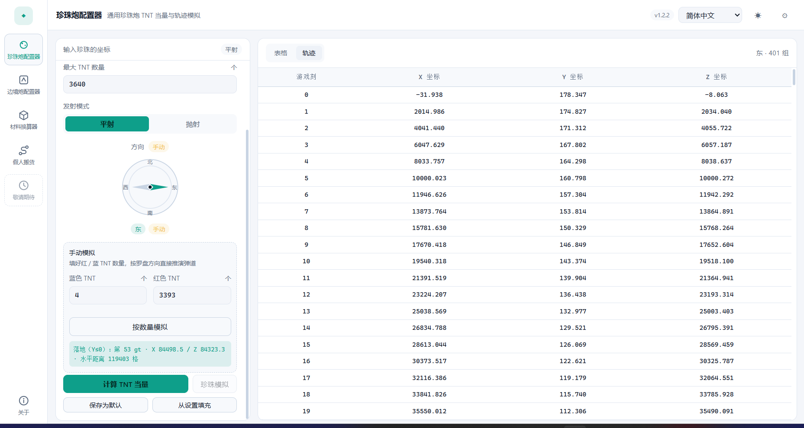


### 2.2 设置项

打开 设置 → 工具参数（默认就是这一页）：

| 设置项 | 说明 |
|---|---|
| 最大 TNT | 单次计算的 TNT 上限，默认 3640 |
| 单个阵列 TNT | 一个阵列的 TNT 当量，默认 260 |
| 炮口 X / 炮口 Z | 默认炮口坐标，默认 `-31.9375 / -8.0625` |
| 目标 X / 目标 Z | 打开工具时预填的目标坐标，默认 `0 / 0` |
| 发射模式 | 默认选平射还是抛射 |
| 启用抛射 | 关闭后界面不提供抛射模式 |
| 平射：XZ 动量 / Y 动量 / 初始 Y 动量 / 初始 Y 位置 | 平射弹道参数，由实测调试得到，**不建议随意修改** |
| 抛射：同上四项 | 抛射弹道参数 |

设置保存后立即生效。数值与旧版 `LSP_PearlCannonConfig` 逐行对齐，修改动量参数会直接改变计算结果。

---

## 3. 边境炮配置器

### 3.1 使用

输入区分成两张独立卡片，避免把目的地填进炮口：

1. **炮口（珍珠初始位置）**：起点，X / Y / Z。
2. **目的地（珍珠落点）**：终点，X / Y / Z。
3. **预计飞行时间**（gt）。

点击**计算 TNT 当量**后，结果表按飞行时间逐刻列出三个 TNT 的配置与方向（默认 100 组）。选中任意一行，底部「配置解码」会显示：

- **预计落点坐标**（X / Z，保留三位小数）
- 三个 TNT 各自的**小头**（剩余 TNT）与**大头**（780 满当量蓄力次数），例如 `371 = 260 + 80 + 20 + 10 + 1`、`78 = 40 + 20 + 10 + 8`
- 三轴动量，以及一键复制完整解码文本

也可以不计算结果：在「手动落点预报」里填三个 TNT 数量、选方向、填**飞行时间**，点**计算落点预报**，下方直接给出落点、该 gt 的珍珠位置（X / Y / Z）、三轴动量、小头 / 大头与可复制的完整文本。方向对应炮口指向的八个方位（东南偏东、东南偏南……），按当前炮口位置自动算方向时与结果表一致。

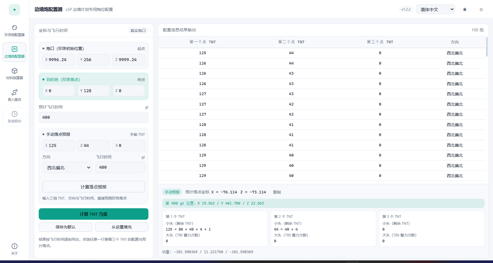

同样支持**保存为默认**与**从设置填充**。


### 3.2 设置项

| 设置项 | 说明 |
|---|---|
| 炮口 X / Y / Z | 默认炮口坐标 |
| 目的地 X / Y / Z | 默认目的地坐标 |
| 预计飞行时间 | 默认飞行时间（gt） |
| 方向判定基准 | `真实炮口`：按当前炮口坐标计算方向（推荐）；`兼容旧版`：沿用旧版写死的 `(10000, 10000)` |

> 长飞行时间下可能出现负数 TNT（旧版同样无解），表格会提示「此时长下无有效配置」，缩短飞行时间或调整目的地即可。

---

## 4. 材料换算器

用于把投影模组（Litematica）导出的材料清单换算成「潜影盒 / 组 / 个」，并给出装填方案。


### 4.1 导入材料清单

- 点击**导入材料列表**可一次选择**多份**文件（再点一次继续追加）：支持投影模组导出的材料清单（**CSV / TXT**，编码 GBK / UTF-8）以及 **`.litematic` 投影**，两类可以混选。
- `.litematic` 按**物品形式**统计，而不是按方块形态：墙上的告示牌/火把/头颅、含水/熔岩/细雪的炼药锅、红石线、作物等都会折算成对应的可收集物品（告示牌、火把、炼药锅、红石粉、种子等），朝向、含水等 `Properties` 变体自动合并。
- 水与岩浆只统计**源头**（能舀成桶），流动形态不计数；气泡柱、火、灵魂火、活塞头、下界传送门、边界方块等**没有物品形式**的方块会被过滤。鼠标悬停在清单行上可看到「区域数 · 方块数 · 过滤数」。
- 投影材料名跟随**当前界面语言**（简体中文 / 繁體中文 / English）：切换语言后已导入的投影会立即按新语言重新统计，无需重新导入。
- 每份清单在左栏占一行：勾选框决定它是否参与换算，右侧显示该清单的「种类 · 数量」，`✕` 可移除；取消勾选会立即按剩余清单重算。
- 多份清单按**材料名称合并数量**（同名相加）：投影材料名与同语言的 Litematica CSV 名称一致，混合导入时同名材料会正确相加。
- CSV 表头识别：优先按列名取「名称」和「数量」，Litematica 的 `Item, Total, Missing, Available` 会取 **Total** 列；没有表头时回退为「名称 数量」逐行解析。
- 材料列表、换算结果、装填与导出都只使用**当前勾选**的清单；堆叠覆盖与忽略名单按材料名全局生效。
- 追加导入不会清空堆叠与忽略设置，但会清空材料勾选与导出文件名。

### 4.2 搜索与排序

- 列表上方是搜索框：输入即过滤，并弹出最多 8 条匹配建议（点击或按 `Enter` 填入，`Esc` 或 `✕` 清空）。
- 「全选」只作用于**当前过滤结果**，方便先搜「染色玻璃」再批量处理。
- 点列表头的「数量 ▼」可在升序/降序间切换，默认降序。
- 结果表右侧有**堆叠筛选**：`全部 / 64 / 16 / 1`，只看某一档的材料；点「数量」表头同样可排序。

### 4.3 堆叠数：默认值与批量修改

- **默认堆叠数**：`64` / `16` / `1（不可堆叠）` 三档，决定没有被单独设置的材料怎么算。
- **批量修改**：勾选若干材料 → 在批量条选择 64 / 16 / 1 → 点**应用到所选**。完成后勾选会自动清空，避免误操作下一批。
- 被单独设置过的材料，列表里会用青色芯片标出当前堆叠数；结果表的「堆叠」列显示每条材料实际使用的值。
- 选 `1` 时按「每格 1 个」计算，不再出现「组」，余量全部计入「个」。

### 4.4 忽略材料

- 勾选材料后点**忽略所选**，它们会从换算、装填和导出中剔除；选中项全部是已忽略时，按钮变成**恢复所选**。
- 列表下方的「已忽略的材料」窗口会列出被忽略的材料与数量，可逐条**恢复**或**全部恢复**。
- 被忽略的材料仍留在列表中（名称加删除线 + 「已忽略」标签），方便核对。

### 4.5 换算结果

结果表列为「材料名称 / 堆叠 / 数量 / 潜影盒 / 组 / 个」：

- **潜影盒**是整盒数量，**组**和**个**是余量；例如 4766 个 / 64 堆叠 = 2 盒 + 20 组 + 30 个。
- 底部统计：材料种类、总数量、整盒、**折合盒数**（按每种材料分别向上取整后求和，即实际要带的盒子数）、默认单盒容量。
- 名称与数量来自导入清单，装填与导出都使用同一份数据，不会出现两处名称不一致。

### 4.6 装填建议

点击**装填建议**会按「用最少的潜影盒装完所有材料」给出装箱方案：

- 每种材料先折算成**占用格数**：`满组数 + (有零头 ? 1 : 0)`，一盒固定 27 格。
- 按格数从大到小逐盒填满，盒数等于 `ceil(总格数 / 27)`，即理论最少值。
- 同一种材料连续装满多个盒子时，这几盒会**合并成一张卡片**（标题形如 `1–2 号盒`，并标注「合装 N 盒」），避免大量重复卡片占满页面；混合装或未装满的盒子仍单独显示。
- 弹窗有两种视图：盒数 ≤ 12 默认**卡片**（每盒一张卡，显示容量条与材料明细），更多时默认**列表**（左列盒号、右侧该盒明细），标题栏可随时切换；两种视图都有独立滚动条。
- 卡片高度随材料种类数不同，采用**拼图式排布**：按实测高度跨行摆放，短卡片下方不会留下整行空档。
- 每盒显示「材料名称 · 组/个 · 占几格」，底部可**复制装填清单**，按盒号依次装填即可。


### 4.7 导出 CSV

左栏底部有两项导出设置：

- **导出文件名**：留空时自动使用 `<导入文件名>_converted.csv`；勾选多份清单时用 `merged_converted.csv`。
- **导出目录**：留空时使用当前数据目录下的 `output`（默认即 `<exe 同级>/data/output`），也可以点「选择…」指定其他目录；设置会保存，下次沿用。

导出内容与当前**筛选、排序**一致，编码为 UTF-8 BOM，Excel 直接打开不乱码。

### 4.8 设置项

| 设置项 | 说明 |
|---|---|
| 最大堆叠数 | `64` / `16` / `1`，新建换算时的默认堆叠数 |
| 潜影盒格数 | 每个潜影盒的格数，默认 27，整合包改动后可调整 |
| 导出目录 | 导出 CSV 的默认目录，留空为数据目录下的 `output` |

---

## 5. 假人搬货

把「盒数 → 假人数 → 批次 → 命令」算清楚，可选直接打进游戏。工具只负责生成 / 清除假人，货站本身的装货与运输仍由游戏内的结构完成。

### 5.1 站点

「站点」保存**分组 tag**、名称、维度、坐标与前缀。分组 tag 会显示在订单下拉框和下方站点列表里：点开下拉框先看到分组 tag，点一个 tag 就只列出该分组下的地名（地名前不再重复 tag）；选中后收起显示为 `重溟洋工业区 · 全物品`。所以名称可以只写地点本身（`全物品`），不用把工业区名塞进名字。

可以新增、编辑、删除，也可以导入旧版配置：

- 旧工具的 `stops.json`（对象形式，字段与旧版一致）；
- 每行「名称 x y z 前缀 [分组] 维度」的文本，前缀里的 `end_` / `ov_` / `nether_` 会自动识别维度并去掉。

旧数据里形如「工业区·地点」的名称会在读取时自动拆成分组 + 名称；分组 tag 不能包含空格。备注最多 60 字，鼠标悬停在站点卡片上时在卡片内显示，自动换行但最多两行。下方站点列表也能按分组 tag 筛选（全部 / 各分组），与订单下拉框的筛选方式一致。

也可以把当前站点导出为 JSON（可再次导入）或「名称 x y z 前缀 分组 维度」文本；导出默认写到数据目录的 `output`。

假人名由模板拼成，默认 `bot_{origin}_{dest}_{index}`；总长必须在 3–16 个字符之间（Minecraft 用户名限制），前缀过长时会直接报错并提示缩短。

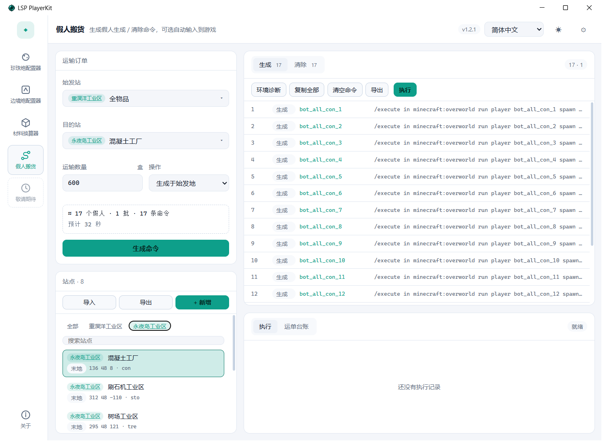

### 5.2 生成命令

选择始发站、目的站、运输数量（盒）与操作：

- 每假人默认带 36 盒，每批默认 24 人（864 盒），都能在设置里改；
- 假人数 = ⌈盒数 / 每假人盒数⌉，再按每批人数切分；
- 「生成于始发地」/「生成于目的地」决定 spawn 命令落在哪个站点；两者通常配合使用：先在始发地把假人生成出来装货，装完清掉，再在目的地重新生成同一批假人卸货；
- 结果分「生成 / 清除」两页，可以复制全部或导出 `.txt`（导出文件也可以直接当 `.mcfunction` 用）；「复制全部」旁边的「清空命令」可以一键清空当前预览。
- 订单（始发站 / 目的站 / 数量 / 操作）会自动记在数据目录里，下次打开应用时自动填回；站点被删掉时会退回默认选择。

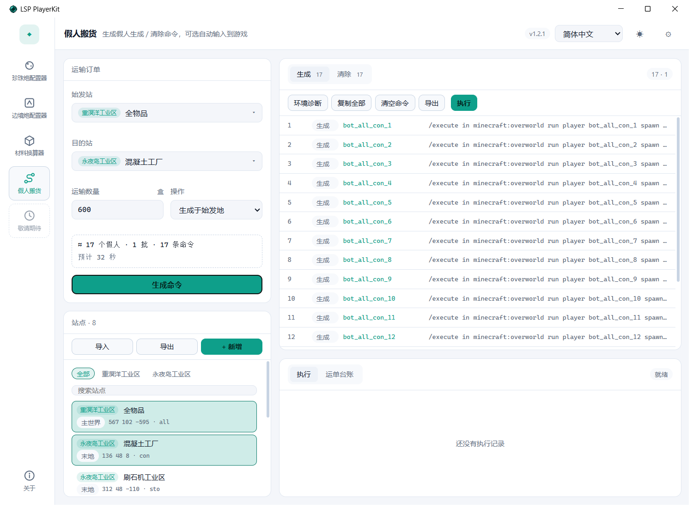

命令形如：

```text
/execute in minecraft:the_end run player bot_all_con_1 spawn at 136 48 8
/player bot_all_con_1 kill
```

**示例：从 A 地搬 600 盒到 B 地（装货 → 换目的地卸货）**

假设 A 地是始发仓库（主世界，坐标 `100 64 -200`，前缀 `a`），B 地是目的地（末地，坐标 `200 48 50`，前缀 `b`）：

1. **在始发地生成假人**：在「站点」里新增 A 地、B 地（分组 tag 都填 `示例`）；订单区选 A 地 → B 地，运输数量 `600`，操作选「生成于始发地」，点「生成命令」。`ceil(600 / 36) = 17` 个假人（17 ≤ 24，1 批），得到 17 条生成命令，名字是 `bot_a_b_1` … `bot_a_b_17`：
   ```text
   /execute in minecraft:overworld run player bot_a_b_1 spawn at 100 64 -200
   ...
   ```
   复制到游戏逐条执行（或开启执行模式），假人出现在 A 地；默认间隔下约 32 秒。
2. **装货**：在游戏里操作 A 地的假人搬货站，把 600 盒装进这 17 个假人。
3. **清除后换到目的地生成**：先切到「清除」页执行这 17 条 `/player bot_a_b_N kill`，把 A 地的假人清掉；再把「操作」改成「生成于目的地」，点「生成命令」并执行，把同一批名字的假人生成到 B 地（末地 `200 48 50`）：
   ```text
   /execute in minecraft:the_end run player bot_a_b_1 spawn at 200 48 50
   ...
   ```
4. **卸货**：在游戏里操作 B 地的假人搬货站卸货；卸完可以再切到「清除」页把这批假人清掉。
5. 「运单台账」会记下每次生成/清除：路线 A 地 → B 地、操作位置 A 地 · 主世界（或 B 地 · 末地）、600 盒 / 17 人；点台账行可以恢复这批命令。

如果要搬 1000 盒：`ceil(1000 / 36) = 28` 人，会切成 24 + 4 两批，每批都按上面的 1 → 4 走一遍。开启执行模式后，「执行」会在每批末尾停下来：界面显示「第 1/2 批已完成」，等你确认这一批在游戏里处理完（装货 / 卸货），再点「继续下一批」发送下一批，避免假人一次性全挤到货站。

### 5.3 执行（可选）

执行默认关闭。到 **设置 → 执行** 打开「允许自动输入」后，可以直接把命令打进 Minecraft：

- 点「执行」先弹确认框，确认后倒计时并自动把游戏窗口切到前台；
- 分批执行时每批结束会停下等你点「继续下一批」；等待期间也可以「中断」；
- 下方「执行」页的日志像命令行窗口一样自动滚动，实时显示已发送条数、当前命令和每条命令的结果；
- 默认用剪贴板粘贴（`Ctrl+A` 后 `Ctrl+V`），功能键按住 0.12 秒；回车前会回探游戏是否卡顿，卡顿就整条重来，避免发出残缺命令；
- 运行中按 `ESC` 立即中断；中断后可以「生成清理命令」，把可能已经生成的假人清掉，已发送条数会写进台账；
- 全部命令发送完后，会再补一条英文聊天消息 `Operation completed successfully`，方便确认这一轮已经跑完；
- 执行前可点「环境诊断」，检查窗口、焦点、剪贴板与管理员权限；
- 游戏以管理员身份运行时，本应用也必须以管理员身份运行，否则 Windows 会丢弃注入的按键。

### 5.4 运单台账

每次执行（完成 / 中断 / 出错）都会记一条：运单号、时间、路线、**操作位置**（这次命令操作的站点与维度）、盒数、假人数、阶段、状态与发送条数。最多保留 200 条，可一键清空。

点击任意一条运单，会在上方命令预览里恢复这次执行保存的命令（生成 / 清除），可以直接复制、导出或再次执行；点「回到当前订单」切回当前生成的命令。

### 5.5 设置项

| 设置项 | 说明 |
|---|---|
| 每假人盒数 | 默认 36；一个假人 36 格，每格放 1 盒 |
| 每批人数 | 默认 24，即 864 盒一批 |
| 假人名模板 | 支持 `{origin}` / `{dest}` / `{index}` |
| 允许自动输入 | 打开后才能执行；执行时会临时抢占焦点 |
| 命令间隔 | 两条命令之间的等待，默认 1 秒 |
| 开始倒计时 | 执行前的准备时间，默认 3 秒 |
| 输入方式 | 剪贴板粘贴（推荐）或逐字输入 |
| 强制切回游戏窗口 | 每条命令前确认游戏在前台 |
| 卡顿重试次数 | 默认 3 次 |
| 结束后还原剪贴板 | 默认开启 |

---

## 6. 史莱姆区块查找器

按世界种子寻找「刷怪圆环内史莱姆区块面积最大」的挂机点。默认圆环为 **24–128 格**：24 格内不刷怪，128 格外怪物会消失。

### 6.1 使用

1. 填**世界种子**（数字，或 `hello` 这样的文本种子，按 Java 规则换算）；输入框会记住最近用过的种子，聚焦或点右侧 `▾` 即可从历史里选；
2. 填**搜索中心 X / Z** 与**搜索半径**（格）；半径 `30,000,000` 约等于全图；
3. 按需调整**圆环内径 / 外径**（默认 24 / 128）与**模拟距离**（服务器 `simulation-distance`，不足 8 时外圈不 tick）；
4. 选择**搜索模式**：`自动`（范围 ≤ 16,777,216 区块时精确扫描，否则采样）、`精确扫描`、`采样搜索`；
5. 点**开始查找**。

结果按「圆环内史莱姆方块数」从高到低排列，并做**非极大值抑制**（默认结果间隔 8 区块），避免 Top 100 全是同一个热点周围的点。

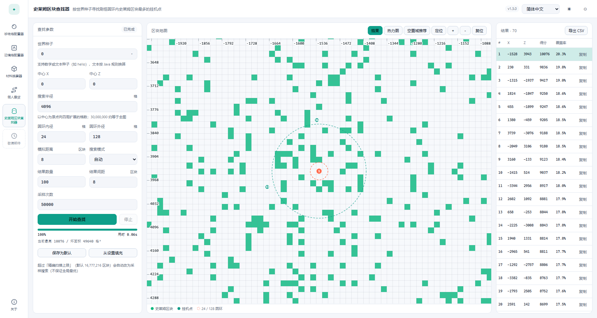

### 6.2 地图与结果

- 选中结果后，中间地图会以该点为中心自动放大到约 40×40 区块：绿色为史莱姆区块，橙色热力为得分，虚线圆是 24 / 128 格圆环；
- 地图上边和左边有坐标刻度，步长随缩放自动在 16 / 32 / 64 … 格之间切换；鼠标悬停会同时显示所在区块与方块坐标；
- 点「空置域推荐」会以当前结果为中心生成默认 21×21 区块的正方形，圆环尽量居中，并在下方列出四角坐标；边长可在设置或卡片里改，小于覆盖圆环所需尺寸会提示；
- 结果列表在右侧独立栏里，点行即可定位并自动缩放；工具栏的「结果」可收起 / 展开侧栏，让地图占满宽度；
- 打开或关闭「空置域推荐」面板、收起 / 展开结果栏、拉伸窗口时，地图保持当前缩放与中心，不会跳回全图；
- 地图上点击标记也能切换结果；支持滚轮缩放、拖动平移，悬停显示区块坐标与是否史莱姆；工具栏的「定位」可重新聚焦当前结果；
- 结果表列出排名、挂机点 X/Z、得分（格²）与覆盖率；右侧按钮复制坐标；
- **导出 CSV** 会带上种子、范围与坐标，方便复现。

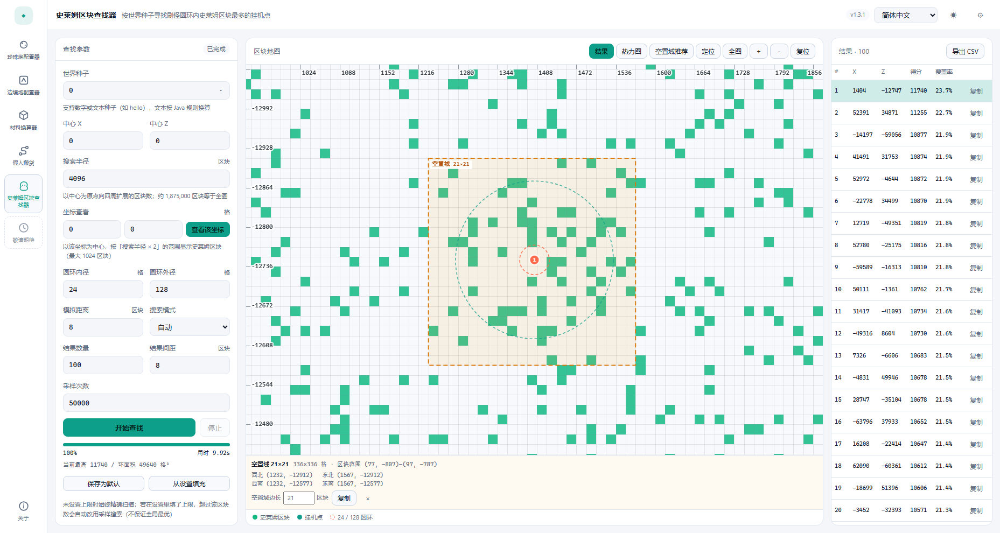

### 6.3 大范围与性能

- **精确扫描**：逐区块算史莱姆位图 + FFT 卷积；1000×1000 区块（100 万）约 1 秒内，10000×10000 区块（1 亿，160k×160k 格）约 10 秒（本机实测，视 CPU 而定）；
- 精确扫描上限默认 4,096×4,096 区块（1,680 万），可在「设置 → 史莱姆区块查找器」里调大（最大 8192×8192）；超过上限**自动改用采样搜索**：随机取 5 万个点 + 局部爬山 + 块内精修，并给出「超过百分之多少的随机点」；
- 全图 60M×60M 是 1.4×10¹³ 个区块，无法穷举；采样搜索是「预算内最优」，不保证全局最优，需要更强保证时请缩小范围做精确扫描。

### 6.4 设置项

| 设置项 | 说明 |
|---|---|
| 世界种子 | 默认 `0` |
| 搜索中心 X / Z | 默认 `-32` / `-8`，打开工具时作为初始中心 |
| 精确扫描上限 | 默认 16,777,216 区块（4096×4096），可调 65,536–67,108,864；超过上限自动改用采样 |
| 空置域边长 | 默认 21×21 区块；必须覆盖刷怪圆环，太小时会提示 |
| 圆环内径 / 外径 | 默认 24 / 128 格 |
| 模拟距离 | 服务器 simulation-distance，默认 8；外半径取 `min(外径, 模拟距离×16)` |
| 结果数量 | 默认 100，最多 500 |
| 结果间距 | NMS 间距，默认 8 区块 |
| 搜索模式 | 自动 / 精确 / 采样 |
| 采样次数 | 默认 50,000 |

---

## 7. 设置

点击右上角齿轮（或 `Ctrl+,`）打开右侧设置抽屉。「工具参数」页会跟随左侧当前选中的工具，下面按应用分别说明；设置保存后立即生效，底部还有「恢复默认」和「导入配置」。

### 7.1 珍珠炮配置器

默认炮口与目标坐标、最大 TNT 数量、单个阵列上限、发射模式，以及平射/抛射的取整参数。完整列表见 [2.2 设置项](#22-设置项)。

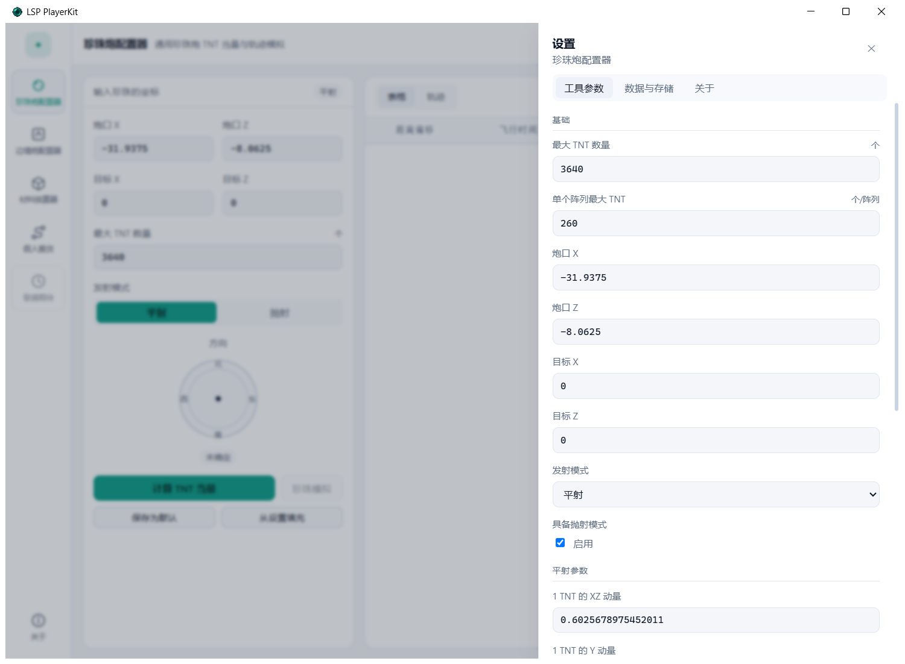

### 7.2 边境炮配置器

默认炮口与目标坐标、预计飞行时间、方向判定基准、是否兼容旧版等。完整列表见 [3.2 设置项](#32-设置项)。

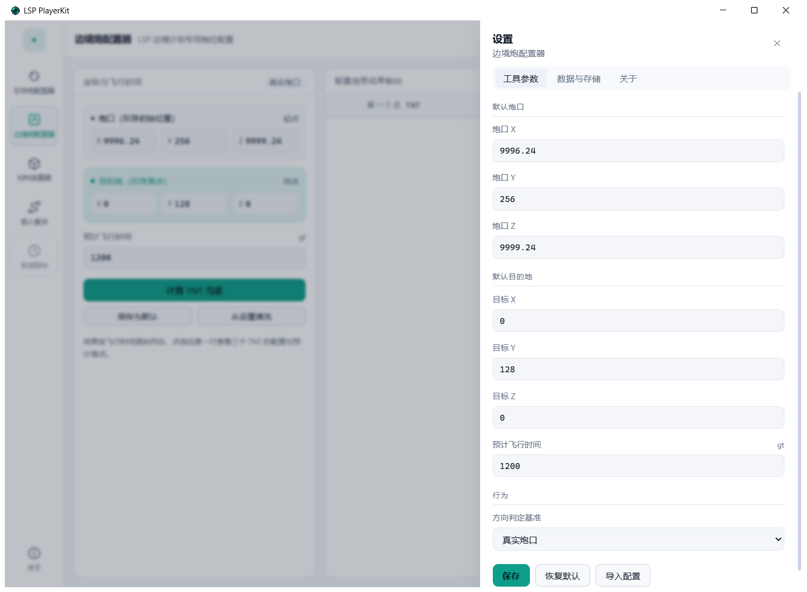

### 7.3 材料换算器

最大堆叠数、潜影盒格数、导出目录与导出格式。完整列表见 [4.8 设置项](#48-设置项)。

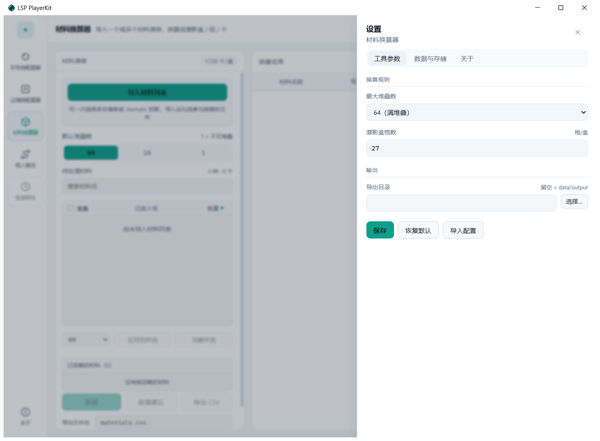

### 7.4 假人搬货

每假人盒数、每批人数、假人名模板，以及执行相关（允许自动输入、命令间隔、倒计时、输入方式、卡顿重试、剪贴板还原）。完整列表见 [5.5 设置项](#55-设置项)。

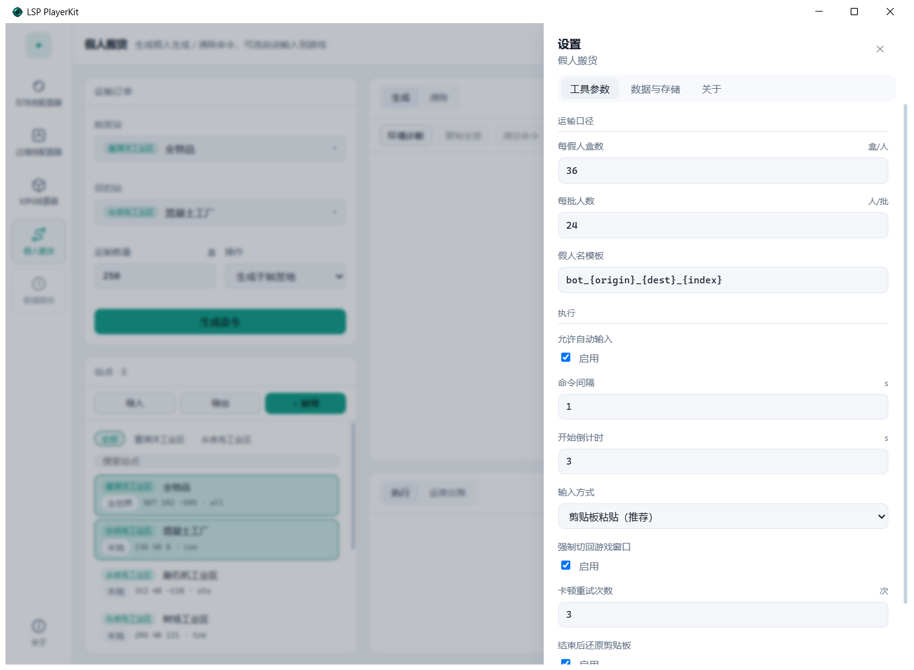

### 7.5 史莱姆区块查找器

默认世界种子、搜索中心 X/Z、精确扫描上限、空置域边长，以及圆环内径 / 外径、模拟距离、结果数量、结果间距、搜索模式与采样次数。完整列表见 [6.4 设置项](#64-设置项)。

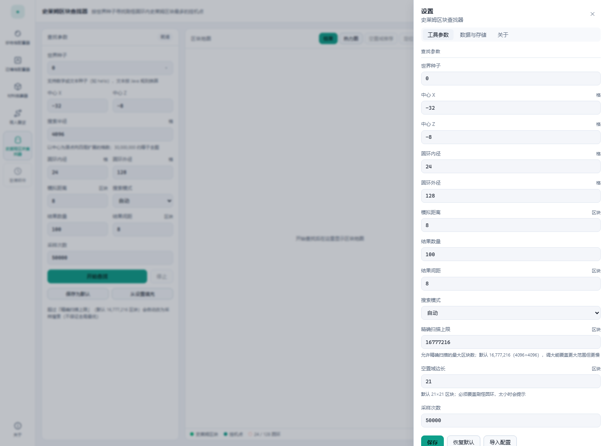

### 7.6 数据与存储

「数据与存储」页可以查看/更改数据目录、打开目录、导出/导入配置包。

**导入配置**支持两种文件：

- 本应用导出的单个 JSON（如 `pearl.json`）；
- 旧版两个项目的 `resources/settings/settings.json`，会自动识别并转换（旧边境炮会置为「兼容旧版」方向模式）。


### 7.7 关于

「关于」页显示版本号、技术栈、隐私说明与开源协议，并提供打开说明文件（中英文 README 的 PDF 版本）和 GitHub 仓库的入口。


---

## 8. 数据与存储

配置默认保存在可执行文件同级的 `data` 目录，**拷贝整个文件夹即可迁移**：

```
<exe 所在目录>/
├─ LSP_PlayerKit.exe
└─ data/
   ├─ settings/
   │  ├─ app.json        语言、主题、窗口状态
   │  ├─ pearl.json      珍珠炮设置
   │  ├─ border.json     边境炮设置
   │  ├─ material.json   材料换算设置
   │  ├─ puppet.json     假人搬货设置
   │  ├─ puppet_stations.json  假人搬货站点
   │  ├─ puppet_orders.json    假人搬货运单台账
   │  └─ puppet_draft.json     上次的订单（始发 / 目的 / 数量 / 操作）
   ├─ output/            导出的 CSV（默认目录）
   ├─ backups/           每次保存前的快照，保留最近 5 份
   └─ .lock              防止多开互相覆盖
```

数据目录解析顺序（先命中者生效）：

1. 命令行 `--data-dir` 或环境变量 `LSPKIT_DATA_DIR`
2. `<exe 同级>/portable.json`（绿色便携模式）
3. `%APPDATA%\LSP_PlayerKit\location.json`（用户改过的位置）
4. 默认 `<exe 同级>/data`；如果不可写（例如装在 `Program Files`），自动回退到 `%APPDATA%\LSP_PlayerKit\data` 并在界面提示

其它行为：

- 所有写入都是「临时文件 + 替换」，JSON 损坏时自动回退最近备份。
- **导出/导入配置包**为 zip，包含全部设置，换机器时一次带走。
- 窗口尺寸、是否最大化记录在 `app.json`，下次启动自动恢复。


---

## 9. 计算说明与已知限制

- 珍珠炮的平射/抛射取整与枚举顺序、边境炮的三元求解，都与旧版实现逐行对齐，仓库内用旧项目生成的数值快照做回归测试。
- 边境炮在部分长飞行时间下会解出负数 TNT（旧版同样无解），表格会提示「此时长下无有效配置」。
- 材料换算的「盒数」按 27 格/盒计算；「折合盒数」是对每种材料分别向上取整后求和，是实际需要携带的潜影盒数量。
- 装填建议的盒数是理论最小值，但同一种材料可能被拆到相邻两个盒子里，弹窗中会按盒号列清楚。
- 材料名称、数量完全来自导入清单；换算只改变「装几盒、几组、几个」，不会重命名材料。
- 假人搬货只负责生成与清除假人，装货、运输、卸货仍由货站结构完成；执行被中断时可能留下已生成的假人，用台账旁的「生成清理命令」补齐。
- 执行模式仅支持 Windows，并且只认 `GLFW30` / `LWJGL` 类的游戏窗口（启动器窗口不会被误认）；游戏是否需要管理员权限取决于你的启动方式。
- 是否存在「自动输入算违规」由服务器规则决定，执行前请自行确认。
- 史莱姆区块查找器只支持 **Java 版**；得分按「圆环内史莱姆区块的方块面积」估算，不模拟地形、洞穴与刷怪层高度，实际刷怪效率还会受服务器模拟距离、光照与农场设计影响。
- 全图 60M×60M 无法穷举：超过 4,096×4,096 区块会自动改用采样搜索，结果是预算内最优，不保证全局最优。

---

## 随应用附赠的小工具

下载包里还附带四个控制台小工具（双击运行，按提示输入，输入 `n` 结束）。它们不参与本应用的运行，日常使用不需要；源码在仓库 `src/tool_bundles/`，构建脚本保留在本地 `packaging/`（不入库），可用 PyInstaller 自行重新打包。

| 工具 | 用途 | 说明 |
|---|---|---|
| `ConfigGenerator.exe` | 珍珠炮技术参数生成器 | 按提示用 `/log projectiles full` 的实测数据反推动量，生成可导入的 `<名字>.json`（写在 exe 同目录）。每项输入都带格式说明与样例，保存后会打印完整路径 |
| `MainCannonConfigMaker.exe` | 主炮配置信息记录器 | 输入目的地、坐标、方向、蓝/红阵列 TNT，输出一段排版好的配置文本，方便发公告或存档 |
| `BorderCannonConfigMaker.exe` | 边境炮配置信息记录器 | 输入目的地、坐标、方向、三个 TNT 的小头/大头，输出配置文本 |
| `StationConfigMaker.exe` | 假人搬货站点生成器 | 逐项输入分组 tag、名称、维度、坐标、前缀与备注，生成 `{"version":1,"stations":[...]}` 的 JSON（写在 exe 同目录），直接在「假人搬货 → 导入」里读取 |

坐标按 `(a, b)` 输入，用英文括号和逗号。`ConfigGenerator.exe` 生成的 JSON 键名已是 `XZ_INIT_POSITION`，可以直接在珍珠炮工具里导入；旧版生成器产出的、键名写成 `XZ_INIT_POSTION` 的文件会被忽略该项并回退到默认炮口，手工把键名改对即可。

## 技术栈

Python 3.9 + pywebview 6 + Vue 3 + Vite + numpy

## License

GPL-3.0 license
