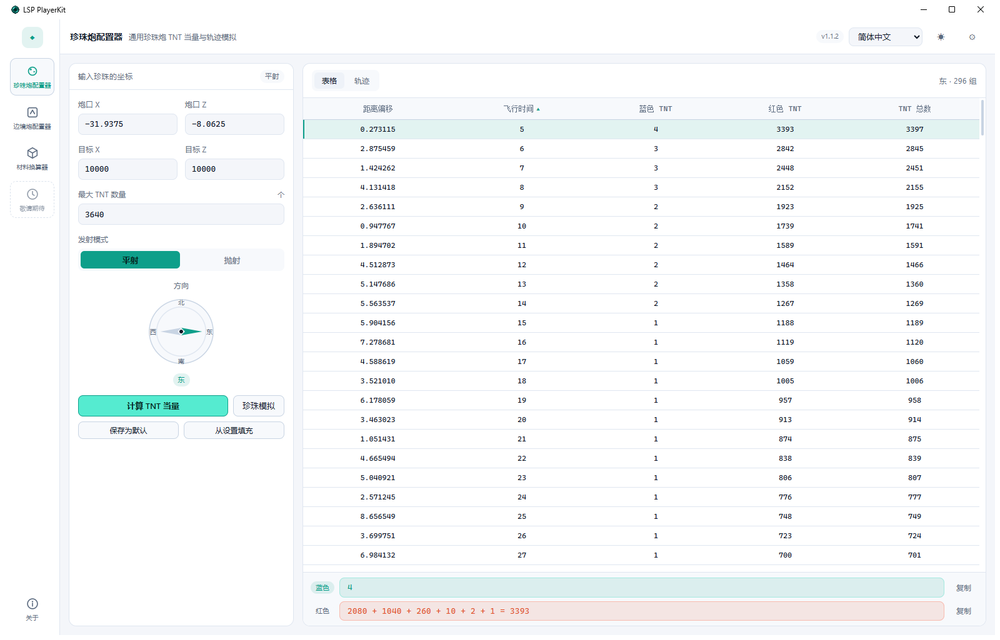
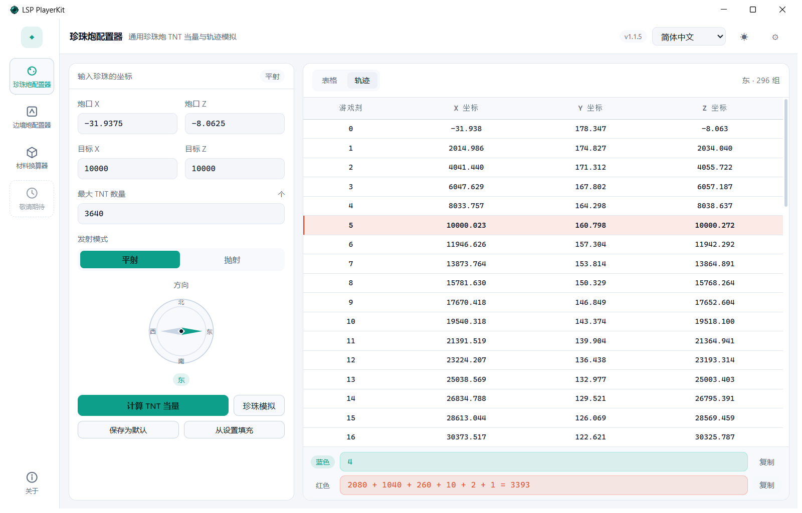
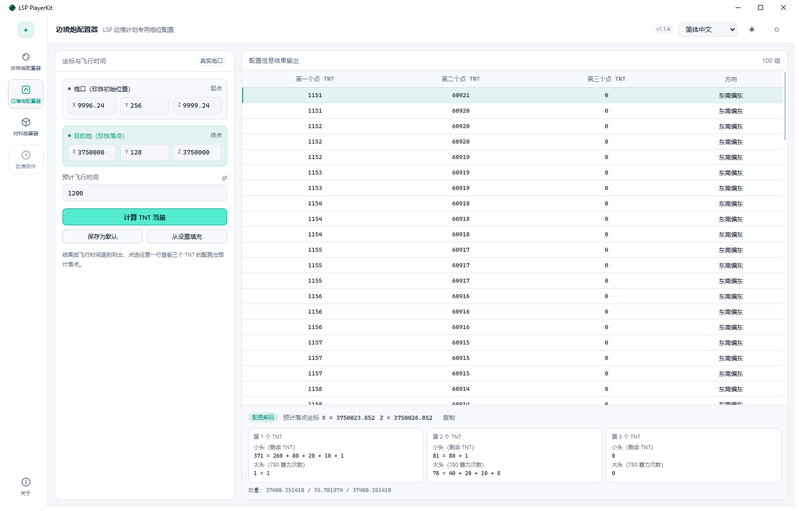
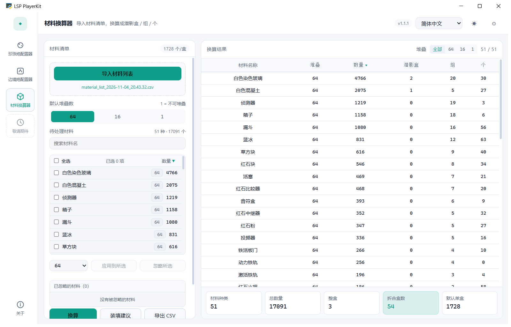
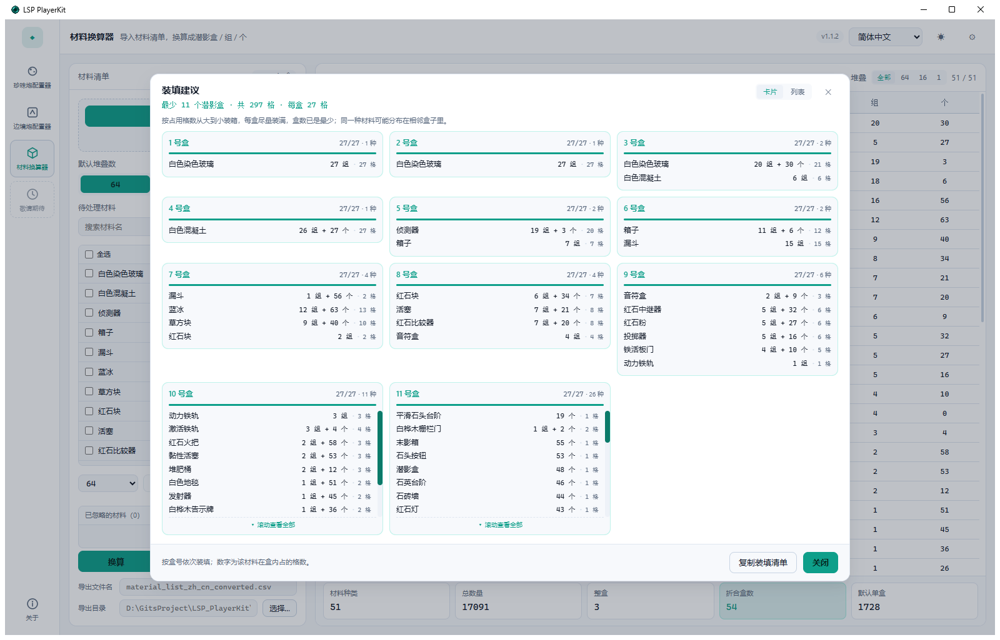
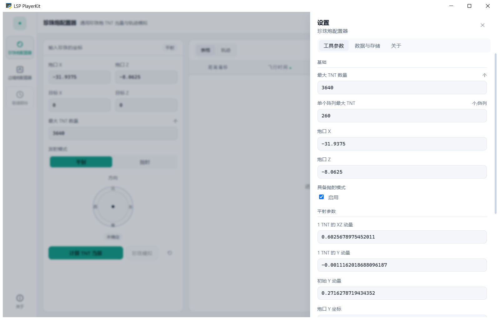
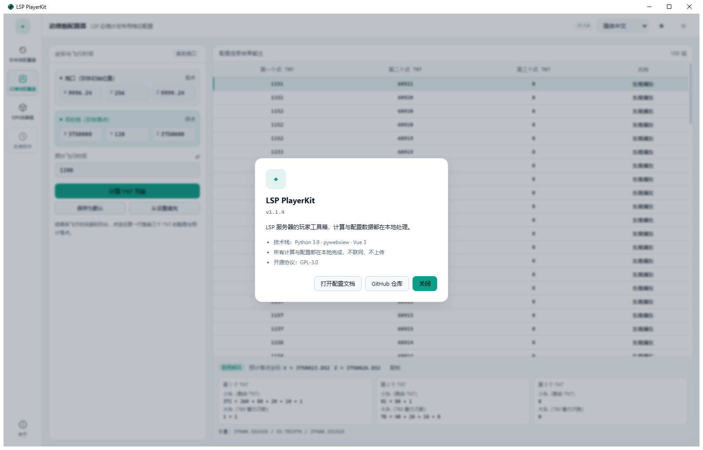
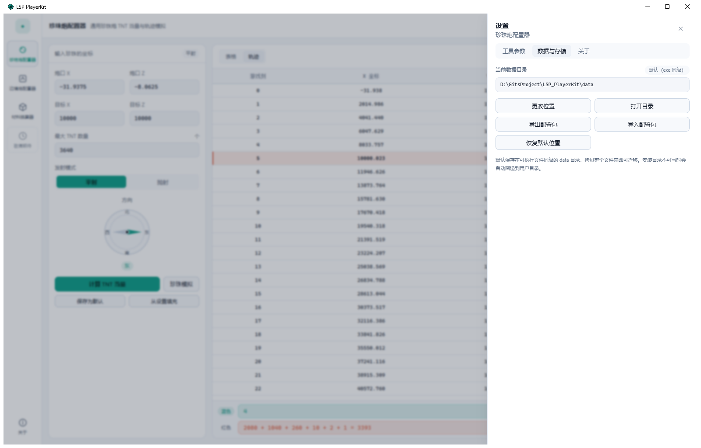

# LSP 玩家工具箱

> LSP 服务器玩家的桌面工具箱，把「通用珍珠炮配置器」「边境炮配置器」和「材料换算器」合并成了同一个应用。 \
> 计算与配置全部在本地完成，不联网、不上传。 \
> 最新版本可从 [百度网盘](https://pan.baidu.com/s/1V3FcoPrWUt3bGQZ-vHqBZg?pwd=1234) 下载（提取码 `1234`）。 😘😘😘

[English](docs/README.en.md) · [新增工具说明](ADDING_A_TOOL.md)

## 目录

- [LSP 玩家工具箱](#lsp-玩家工具箱)
  - [目录](#目录)
  - [下载](#下载)
  - [1. 快速开始](#1-快速开始)
  - [2. 珍珠炮配置器](#2-珍珠炮配置器)
    - [2.1 使用](#21-使用)
    - [2.2 设置项](#22-设置项)
  - [3. 边境炮配置器](#3-边境炮配置器)
    - [3.1 使用](#31-使用)
    - [3.2 设置项](#32-设置项)
  - [4. 材料换算器](#4-材料换算器)
    - [4.1 导入材料清单](#41-导入材料清单)
    - [4.2 搜索与排序](#42-搜索与排序)
    - [4.3 堆叠数：默认值与批量修改](#43-堆叠数默认值与批量修改)
    - [4.4 忽略材料](#44-忽略材料)
    - [4.5 换算结果](#45-换算结果)
    - [4.6 装填建议](#46-装填建议)
    - [4.7 导出 CSV](#47-导出-csv)
    - [4.8 设置项](#48-设置项)
  - [5. 设置](#5-设置)
  - [6. 数据与存储](#6-数据与存储)
  - [7. 计算说明与已知限制](#7-计算说明与已知限制)
  - [随应用附赠的小工具](#随应用附赠的小工具)
  - [技术栈](#技术栈)
  - [License](#license)

---

## 下载

最新版本放在百度网盘：

| 项目 | 内容 |
|---|---|
| 下载链接 | <https://pan.baidu.com/s/1V3FcoPrWUt3bGQZ-vHqBZg?pwd=1234> |
| 提取码 | `1234` |

---

## 1. 快速开始

解压下载的压缩包，双击 `LSP_PlayerKit.exe` 即可运行，不需要安装 Python 或 Node。

界面分三块：

- **左侧工具轨**：珍珠炮配置器、边境炮配置器、材料换算器、「敬请期待」占位、「关于」。
- **顶部命令栏**：当前工具名称与说明、语言切换（English / 简体中文 / 繁體中文）、深浅主题切换、设置齿轮。
- **工作区**：左侧参数、右侧结果，两个工具页布局一致。

快捷键：`Ctrl+1 / Ctrl+2 / Ctrl+3` 依次切换三个工具，`Ctrl+,` 打开设置。窗口尺寸与最大化状态会自动记住。



---

## 2. 珍珠炮配置器

### 2.1 使用

从「输入珍珠的坐标」开始：

1. 填写**炮口 X / Z**、**目标 X / Z** 和**最大 TNT**。
2. 选择**发射模式**：平射或抛射（设置里关闭「启用抛射」后，抛射按钮不可用）。
3. **方向**由罗盘显示：计算完成后自动指向结果方向；也可以手动点选四个方位，此时会显示「手动」标记。
4. 点击**计算 TNT 当量**。

结果与操作：

- 结果表列为「距离偏移 / 飞行时间 / 蓝色 TNT / 红色 TNT / TNT 总数」，默认按**飞行时间升序**；点击「距离偏移」或「飞行时间」表头切换升序/降序，再点一次反向。
- 选中任意一行，底部显示该配置的蓝、红 TNT 阵列拆解，格式为 `20 + 10 + 2 + 1 = 33`，右侧「复制」可直接粘贴到聊天或笔记。
- 点击**珍珠模拟**会按当前选中的配置逐 gt 推算位置，切到「轨迹」页；表格列为「游戏刻 / X / Y / Z」，预计到达时刻那一行用橙色高亮，并自动滚动到可视区域。
- **保存为默认**把当前炮口、目标、最大 TNT 和发射模式写回设置，下次启动自动填入；**从设置填充**用已保存的默认值覆盖当前输入。



### 2.2 设置项

打开 设置 → 工具参数（默认就是这一页）：

| 设置项 | 说明 |
|---|---|
| 最大 TNT | 单次计算的 TNT 上限，默认 3640 |
| 单个阵列 TNT | 一个阵列的 TNT 当量，默认 260 |
| 炮口 X / 炮口 Z | 默认炮口坐标，默认 `-31.9375 / -8.0625` |
| 目标 X / 目标 Z | 打开工具时预填的目标坐标，默认 `0 / 0` |
| 发射模式 | 默认选平射还是抛射 |
| 启用抛射 | 关闭后界面不提供抛射模式 |
| 平射：XZ 动量 / Y 动量 / 初始 Y 动量 / 初始 Y 位置 | 平射弹道参数，由实测调试得到，**不建议随意修改** |
| 抛射：同上四项 | 抛射弹道参数 |

设置保存后立即生效。数值与旧版 `LSP_PearlCannonConfig` 逐行对齐，修改动量参数会直接改变计算结果。

---

## 3. 边境炮配置器

### 3.1 使用

输入区分成两张独立卡片，避免把目的地填进炮口：

1. **炮口（珍珠初始位置）**：起点，X / Y / Z。
2. **目的地（珍珠落点）**：终点，X / Y / Z。
3. **预计飞行时间**（gt）。

点击**计算 TNT 当量**后，结果表按飞行时间逐刻列出三个 TNT 的配置与方向（默认 100 组）。选中任意一行，底部「配置解码」会显示：

- **预计落点坐标**（X / Z，保留三位小数）
- 三个 TNT 各自的**小头**（剩余 TNT）与**大头**（780 满当量蓄力次数），例如 `371 = 260 + 80 + 20 + 10 + 1`、`78 = 40 + 20 + 10 + 8`
- 三轴动量，以及一键复制完整解码文本

同样支持**保存为默认**与**从设置填充**。



### 3.2 设置项

| 设置项 | 说明 |
|---|---|
| 炮口 X / Y / Z | 默认炮口坐标 |
| 目的地 X / Y / Z | 默认目的地坐标 |
| 预计飞行时间 | 默认飞行时间（gt） |
| 方向判定基准 | `真实炮口`：按当前炮口坐标计算方向（推荐）；`兼容旧版`：沿用旧版写死的 `(10000, 10000)` |

> 长飞行时间下可能出现负数 TNT（旧版同样无解），表格会提示「此时长下无有效配置」，缩短飞行时间或调整目的地即可。

---

## 4. 材料换算器

用于把投影模组（Litematica）导出的材料清单换算成「潜影盒 / 组 / 个」，并给出装填方案。



### 4.1 导入材料清单

- 点击**导入材料列表**，选择投影模组导出的材料清单 CSV。文件编码支持 **GBK / UTF-8**，无需手动转码。
- 支持带表头的 CSV：优先按列名取「名称」和「数量」，Litematica 的 `Item, Total, Missing, Available` 会取 **Total** 列；没有表头时回退为「名称 数量」逐行解析。
- 导入后左侧列出每种材料的**名称与数量**，并立即完成一次换算；材料名称保持与导入文件**完全一致**（不改大小写、不加前缀）。
- 重新导入会清空当前的堆叠覆盖、忽略名单和搜索结果。

### 4.2 搜索与排序

- 列表上方是搜索框：输入即过滤，并弹出最多 8 条匹配建议（点击或按 `Enter` 填入，`Esc` 或 `✕` 清空）。
- 「全选」只作用于**当前过滤结果**，方便先搜「染色玻璃」再批量处理。
- 点列表头的「数量 ▼」可在升序/降序间切换，默认降序。
- 结果表右侧有**堆叠筛选**：`全部 / 64 / 16 / 1`，只看某一档的材料；点「数量」表头同样可排序。

### 4.3 堆叠数：默认值与批量修改

- **默认堆叠数**：`64` / `16` / `1（不可堆叠）` 三档，决定没有被单独设置的材料怎么算。
- **批量修改**：勾选若干材料 → 在批量条选择 64 / 16 / 1 → 点**应用到所选**。完成后勾选会自动清空，避免误操作下一批。
- 被单独设置过的材料，列表里会用青色芯片标出当前堆叠数；结果表的「堆叠」列显示每条材料实际使用的值。
- 选 `1` 时按「每格 1 个」计算，不再出现「组」，余量全部计入「个」。

### 4.4 忽略材料

- 勾选材料后点**忽略所选**，它们会从换算、装填和导出中剔除；选中项全部是已忽略时，按钮变成**恢复所选**。
- 列表下方的「已忽略的材料」窗口会列出被忽略的材料与数量，可逐条**恢复**或**全部恢复**。
- 被忽略的材料仍留在列表中（名称加删除线 + 「已忽略」标签），方便核对。

### 4.5 换算结果

结果表列为「材料名称 / 堆叠 / 数量 / 潜影盒 / 组 / 个」：

- **潜影盒**是整盒数量，**组**和**个**是余量；例如 4766 个 / 64 堆叠 = 2 盒 + 20 组 + 30 个。
- 底部统计：材料种类、总数量、整盒、**折合盒数**（按每种材料分别向上取整后求和，即实际要带的盒子数）、默认单盒容量。
- 名称与数量来自导入清单，装填与导出都使用同一份数据，不会出现两处名称不一致。

### 4.6 装填建议

点击**装填建议**会按「用最少的潜影盒装完所有材料」给出装箱方案：

- 每种材料先折算成**占用格数**：`满组数 + (有零头 ? 1 : 0)`，一盒固定 27 格。
- 按格数从大到小逐盒填满，盒数等于 `ceil(总格数 / 27)`，即理论最少值。
- 弹窗有两种视图：盒数 ≤ 12 默认**卡片**（每盒一张卡，显示容量条与材料明细），更多时默认**列表**（左列盒号、右侧该盒明细），标题栏可随时切换；两种视图都有独立滚动条。
- 每盒显示「材料名称 · 组/个 · 占几格」，底部可**复制装填清单**，按盒号依次装填即可。



### 4.7 导出 CSV

左栏底部有两项导出设置：

- **导出文件名**：留空时自动使用 `<导入文件名>_converted.csv`。
- **导出目录**：留空时使用当前数据目录下的 `output`（默认即 `<exe 同级>/data/output`），也可以点「选择…」指定其他目录；设置会保存，下次沿用。

导出内容与当前**筛选、排序**一致，编码为 UTF-8 BOM，Excel 直接打开不乱码。

### 4.8 设置项

| 设置项 | 说明 |
|---|---|
| 最大堆叠数 | `64` / `16` / `1`，新建换算时的默认堆叠数 |
| 潜影盒格数 | 每个潜影盒的格数，默认 27，整合包改动后可调整 |
| 导出目录 | 导出 CSV 的默认目录，留空为数据目录下的 `output` |

---

## 5. 设置

点击右上角齿轮（或 `Ctrl+,`）打开右侧设置抽屉，共三页：

- **工具参数**：当前工具的设置项，由工具自己的 schema 生成；保存后立即生效，底部还有「恢复默认」和「导入配置」。
- **数据与存储**：查看/更改数据目录、打开目录、导出/导入配置包。
- **关于**：版本号、技术栈与文档入口。

**导入配置**支持两种文件：

- 本应用导出的单个 JSON（如 `pearl.json`）；
- 旧版两个项目的 `resources/settings/settings.json`，会自动识别并转换（旧边境炮会置为「兼容旧版」方向模式）。



「关于」页显示版本号、技术栈、隐私说明与开源协议，并提供打开配置文档和 GitHub 仓库的入口。



---

## 6. 数据与存储

配置默认保存在可执行文件同级的 `data` 目录，**拷贝整个文件夹即可迁移**：

```
<exe 所在目录>/
├─ LSP_PlayerKit.exe
└─ data/
   ├─ settings/
   │  ├─ app.json        语言、主题、窗口状态
   │  ├─ pearl.json      珍珠炮设置
   │  ├─ border.json     边境炮设置
   │  └─ material.json   材料换算设置
   ├─ output/            导出的 CSV（默认目录）
   ├─ backups/           每次保存前的快照，保留最近 5 份
   └─ .lock              防止多开互相覆盖
```

数据目录解析顺序（先命中者生效）：

1. 命令行 `--data-dir` 或环境变量 `LSPKIT_DATA_DIR`
2. `<exe 同级>/portable.json`（绿色便携模式）
3. `%APPDATA%\LSP_PlayerKit\location.json`（用户改过的位置）
4. 默认 `<exe 同级>/data`；如果不可写（例如装在 `Program Files`），自动回退到 `%APPDATA%\LSP_PlayerKit\data` 并在界面提示

其它行为：

- 所有写入都是「临时文件 + 替换」，JSON 损坏时自动回退最近备份。
- **导出/导入配置包**为 zip，包含全部设置，换机器时一次带走。
- 窗口尺寸、是否最大化记录在 `app.json`，下次启动自动恢复。



---

## 7. 计算说明与已知限制

- 珍珠炮的平射/抛射取整与枚举顺序、边境炮的三元求解，都与旧版实现逐行对齐，仓库内用旧项目生成的数值快照做回归测试。
- 边境炮在部分长飞行时间下会解出负数 TNT（旧版同样无解），表格会提示「此时长下无有效配置」。
- 材料换算的「盒数」按 27 格/盒计算；「折合盒数」是对每种材料分别向上取整后求和，是实际需要携带的潜影盒数量。
- 装填建议的盒数是理论最小值，但同一种材料可能被拆到相邻两个盒子里，弹窗中会按盒号列清楚。
- 材料名称、数量完全来自导入清单；换算只改变「装几盒、几组、几个」，不会重命名材料。

---

## 随应用附赠的小工具

下载包里还附带三个控制台小工具（双击运行，按提示输入，输入 `n` 结束）。它们不参与本应用的运行，日常使用不需要；源码在仓库 `src/tool_bundles/`，各自对应 `packaging/` 下的一个 spec，可以单独重新打包。

| 工具 | 用途 | 说明 |
|---|---|---|
| `ConfigGenerator.exe` | 珍珠炮技术参数生成器 | 按提示用 `/log projectiles full` 的实测数据反推动量，生成可导入的 `<名字>.json`（写在 exe 同目录）。每项输入都带格式说明与样例，保存后会打印完整路径 |
| `MainCannonConfigMaker.exe` | 主炮配置信息记录器 | 输入目的地、坐标、方向、蓝/红阵列 TNT，输出一段排版好的配置文本，方便发公告或存档 |
| `BorderCannonConfigMaker.exe` | 边境炮配置信息记录器 | 输入目的地、坐标、方向、三个 TNT 的小头/大头，输出配置文本 |

坐标按 `(a, b)` 输入，用英文括号和逗号。`ConfigGenerator.exe` 生成的 JSON 键名已是 `XZ_INIT_POSITION`，可以直接在珍珠炮工具里导入；旧版生成器产出的、键名写成 `XZ_INIT_POSTION` 的文件会被忽略该项并回退到默认炮口，手工把键名改对即可。

## 技术栈

Python 3.9 + pywebview 6 + Vue 3 + Vite + numpy

## License

GPL-3.0 license
