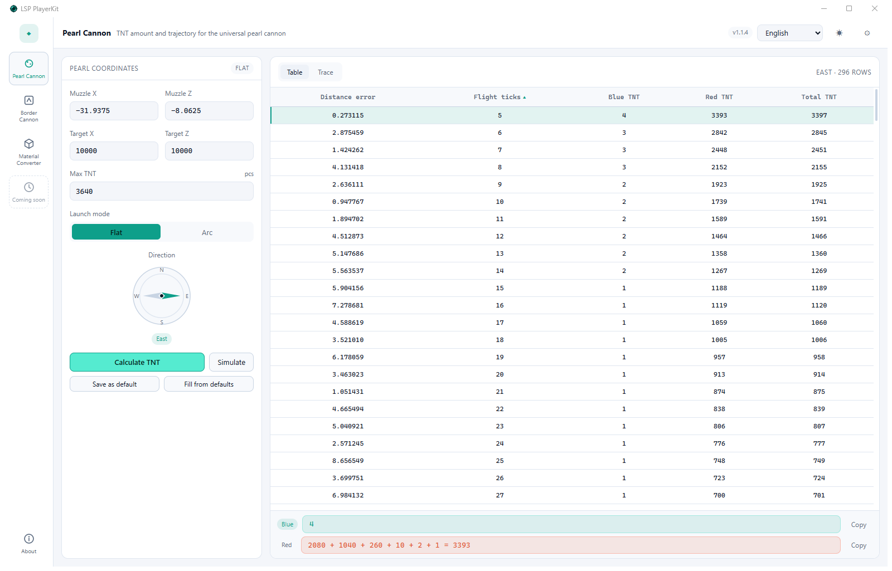
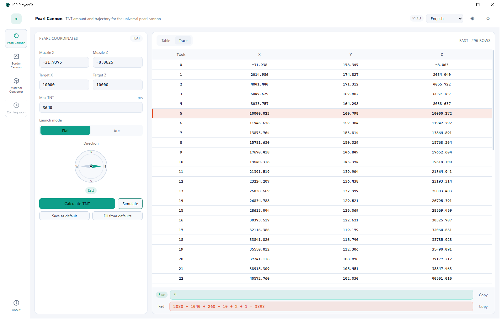
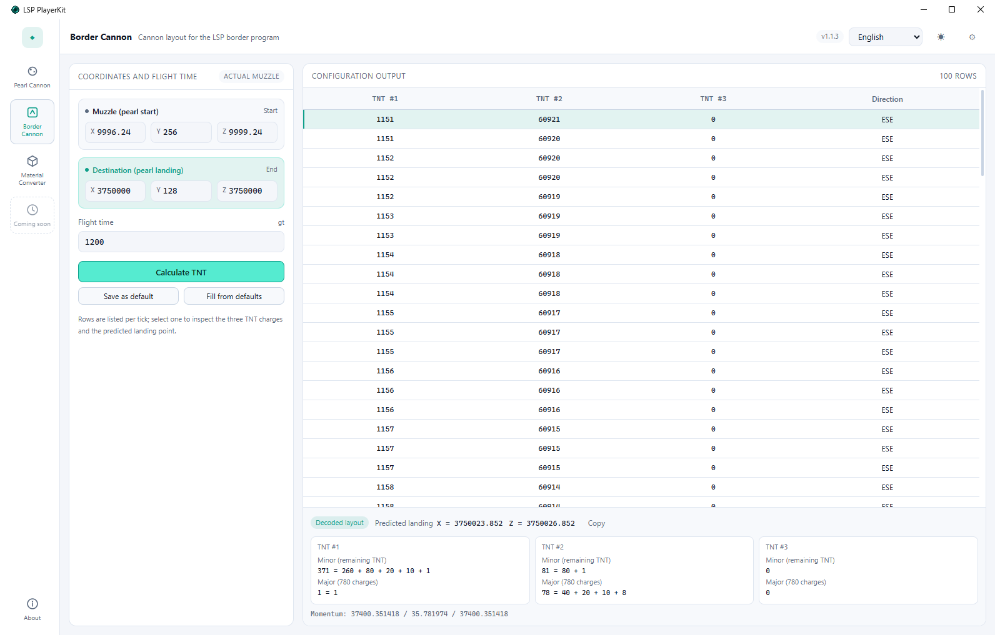
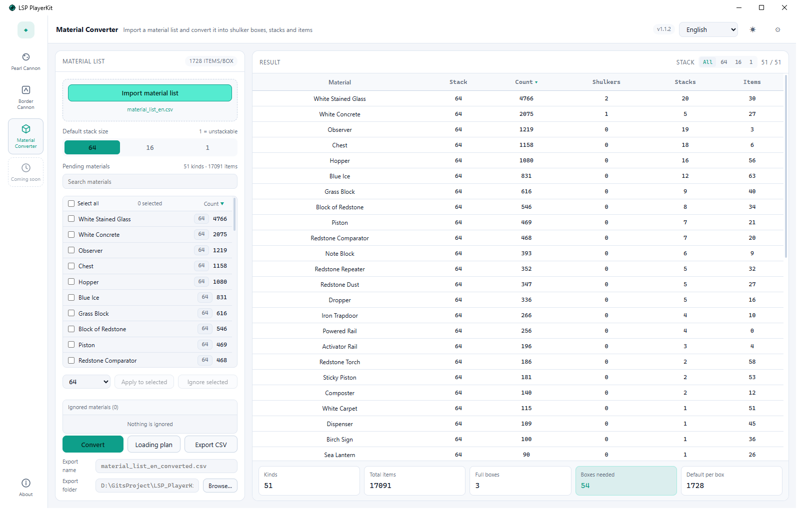
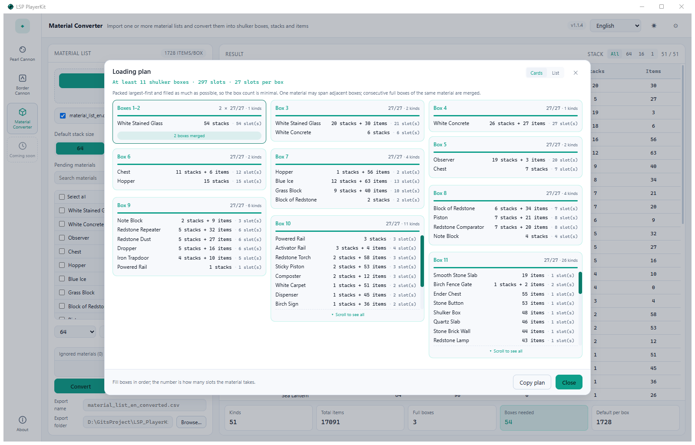
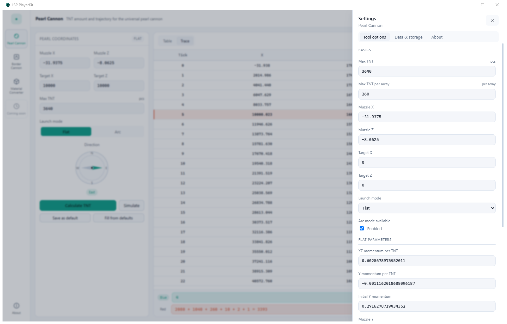
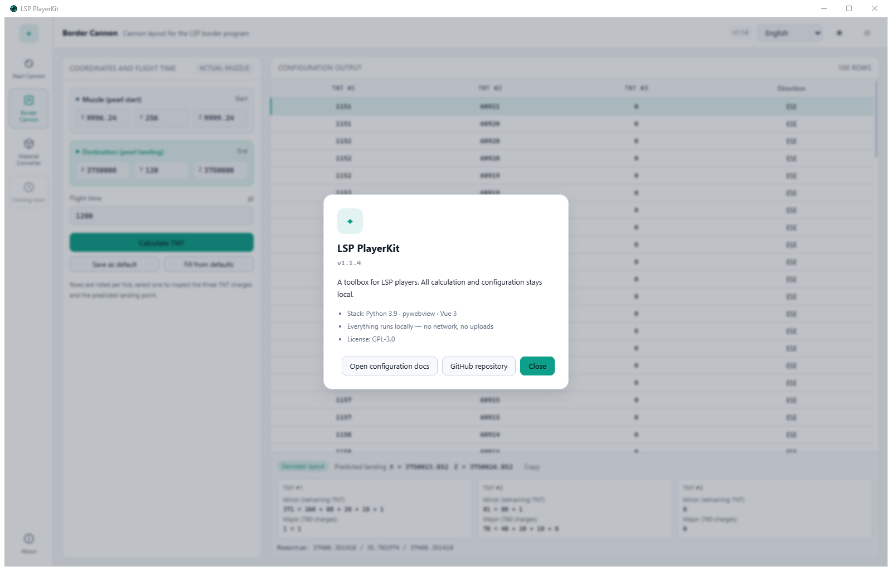
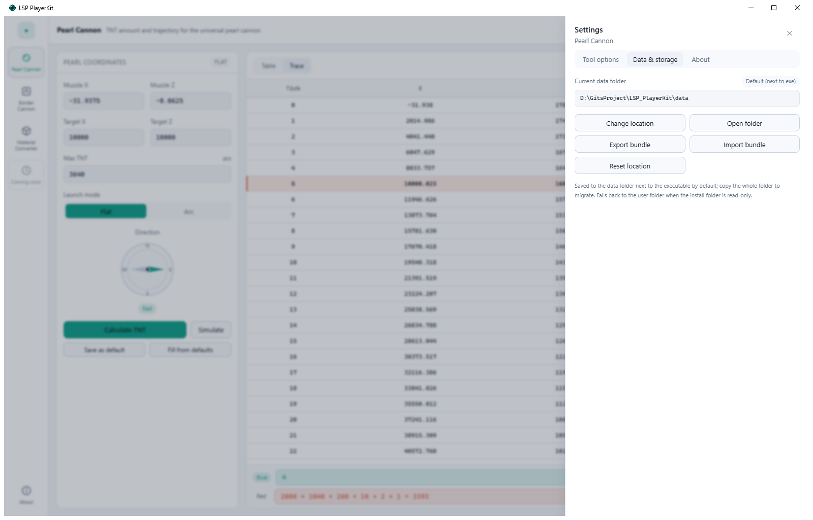

# LSP PlayerKit

> A desktop toolbox for LSP server players. It merges the Universal Pearl Cannon Configurator, the Border Cannon Configurator, a Material Converter and Puppet Logistics into one app. \
> Everything runs locally — no network, no uploads. \
> Download the latest build from [Baidu Netdisk](https://pan.baidu.com/s/1V3FcoPrWUt3bGQZ-vHqBZg?pwd=1234) (code `1234`). 😘😘😘

[简体中文](../README.md) · [Adding a tool](ADDING_A_TOOL.en.md)

## Contents

- [LSP PlayerKit](#lsp-playerkit)
  - [Contents](#contents)
  - [Download](#download)
  - [1. Quick start](#1-quick-start)
  - [2. Pearl cannon](#2-pearl-cannon)
    - [2.1 Usage](#21-usage)
    - [2.2 Settings](#22-settings)
  - [3. Border cannon](#3-border-cannon)
    - [3.1 Usage](#31-usage)
    - [3.2 Settings](#32-settings)
  - [4. Material converter](#4-material-converter)
    - [4.1 Import a material list](#41-import-a-material-list)
    - [4.2 Search and sorting](#42-search-and-sorting)
    - [4.3 Stack size: default and batch](#43-stack-size-default-and-batch)
    - [4.4 Ignoring materials](#44-ignoring-materials)
    - [4.5 Conversion result](#45-conversion-result)
    - [4.6 Loading plan](#46-loading-plan)
    - [4.7 Export CSV](#47-export-csv)
    - [4.8 Settings](#48-settings)
  - [5. Puppet Logistics](#5-puppet-logistics)
    - [5.1 Stations](#51-stations)
    - [5.2 Generating commands](#52-generating-commands)
    - [5.3 Running commands (optional)](#53-running-commands-optional)
    - [5.4 Ledger](#54-ledger)
    - [5.5 Settings](#55-settings)
  - [6. Settings](#6-settings)
  - [7. Data and storage](#7-data-and-storage)
  - [8. Calculation notes and limitations](#8-calculation-notes-and-limitations)
  - [Bundled mini-tools](#bundled-mini-tools)
  - [Stack](#stack)
  - [License](#license)

---

## Download

The latest build is shared on Baidu Netdisk:

| Item | Value |
|---|---|
| Link | <https://pan.baidu.com/s/1V3FcoPrWUt3bGQZ-vHqBZg?pwd=1234> |
| Access code | `1234` |

---

## 1. Quick start

Unzip the downloaded package and double-click `LSP_PlayerKit.exe`. Python and Node are not required.

The window has three parts:

- **Left rail**: Pearl Cannon, Border Cannon, Material Converter, Puppet Logistics, a “Coming soon” placeholder, and About.
- **Top bar**: active tool name and description, language (English / 简体中文 / 繁體中文), light/dark theme, and the settings gear.
- **Workspace**: parameters on the left, results on the right.

Shortcuts: `Ctrl+1 / Ctrl+2 / Ctrl+3 / Ctrl+4` switch tools, `Ctrl+,` opens settings. Window size and the maximized state are remembered.



---

## 2. Pearl cannon

### 2.1 Usage

Start from **Input pearl coordinates**:

1. Fill in **muzzle X / Z**, **target X / Z** and **max TNT**.
2. Pick a **launch mode**: Flat or Arc (Arc is disabled if you turn off “Arc enabled” in settings).
3. The **direction** compass points at the result automatically after a calculation; you can also pick one of the four directions manually, which shows a “Manual” badge.
4. Click **Calculate TNT**.

Results and actions:

- Columns: **Distance error / Flight time / Blue TNT / Red TNT / Total TNT**, sorted by **flight time ascending** by default. Click the **Distance error** or **Flight time** header to sort; click again to reverse.
- Selecting a row shows the blue and red TNT array breakdown at the bottom, e.g. `20 + 10 + 2 + 1 = 33`; **Copy** puts it on the clipboard.
- **Simulate** steps the pearl tick by tick for the selected configuration and switches to the **Trace** tab: columns are **tick / X / Y / Z**, and the expected arrival tick is highlighted in orange and scrolled into view.
- **Save as default** writes the current muzzle, target, max TNT and launch mode back to settings; **Fill from defaults** overwrites the inputs with the saved values.



### 2.2 Settings

Open Settings → Tool options:

| Setting | Description |
|---|---|
| Max TNT | Upper bound for one calculation, default 3640 |
| TNT per array | TNT equivalent of one array, default 260 |
| Muzzle X / Z | Default muzzle position, default `-31.9375 / -8.0625` |
| Target X / Z | Target coordinates pre-filled when the tool opens, default `0 / 0` |
| Launch mode | Default Flat or Arc |
| Arc enabled | When off, the Arc mode is unavailable |
| Flat: XZ motion / Y motion / initial Y motion / initial Y position | Flat trajectory parameters measured in game — **do not change casually** |
| Arc: the same four | Arc trajectory parameters |

Settings apply immediately. The numbers are line-by-line compatible with the legacy `LSP_PearlCannonConfig`; changing the motion parameters changes the results.

---

## 3. Border cannon

### 3.1 Usage

The inputs are two separate cards, so the destination is hard to type into the muzzle by mistake:

1. **Muzzle (pearl start position)**: X / Y / Z.
2. **Destination (pearl landing)**: X / Y / Z.
3. **Expected flight time** in gt.

Click **Calculate TNT**; the table lists three TNT charges and a direction per tick (100 rows by default). Selecting a row shows the **configuration decode** panel:

- **Predicted landing coordinates** (X / Z, three decimals)
- **minor** (remaining TNT) and **major** (780-charge) breakdowns for each of the three TNT, e.g. `371 = 260 + 80 + 20 + 10 + 1`, `78 = 40 + 20 + 10 + 8`
- three-axis momentum, plus one-click copy of the full decode text

**Save as default** and **Fill from defaults** work the same way as in the pearl cannon.



### 3.2 Settings

| Setting | Description |
|---|---|
| Muzzle X / Y / Z | Default muzzle position |
| Destination X / Y / Z | Default destination |
| Expected flight time | Default flight time (gt) |
| Direction reference | `Real muzzle`: direction from the current muzzle (recommended); `Legacy`: the old hard-coded `(10000, 10000)` |

> Long flight times may produce negative TNT (the legacy app had no solution either). The table then shows “No valid configuration for this flight time” — shorten the flight time or adjust the destination.

---

## 4. Material converter

Converts a Litematica material list into **shulker boxes / stacks / items** and produces a loading plan.



### 4.1 Import material lists

- Click **Import material list** to pick **several** files at once (click again to append): material lists (**CSV / TXT**, GBK or UTF-8) and **`.litematic` schematics** can be mixed.
- A `.litematic` is counted by **item form**, not by block form: wall signs/torches/heads, water/lava/powder-snow cauldrons, redstone wire and crops are folded into their collectable items (sign, torch, cauldron, redstone dust, seeds and so on), while facing or waterlogged variants are merged.
- Water and lava count only at the **source** (the state that can be bucketed); bubble columns, fire, soul fire, piston heads, nether portals, barrier-like blocks and other blocks **without an item form** are filtered out. Hover a row to see its region, block and filtered counts.
- The result matches Litematica's Chinese material list exactly: for the same structure both the schematic and the CSV report **51 kinds / 17 091 items** with identical per-item counts.
- Schematic material names follow the **current interface language** (简体中文 / 繁體中文 / English): switching the language re-counts imported schematics immediately, no re-import needed.
- Each list gets a row on the left: the checkbox decides whether it takes part, the row shows that list's kinds · items, and `✕` removes it. Unticking recalculates immediately.
- Lists are merged by **material name** with counts summed: schematic names match Litematica's CSV export in the same language, so the same material from both kinds of source adds up correctly.
- Header detection: name/count columns are read from the header (Litematica's `Item, Total, Missing, Available` uses **Total**), otherwise `name count` lines are parsed.
- The pending list, result, loading plan and export use only the **ticked** lists; stack overrides and the ignore list apply globally by material name.
- Appending lists keeps your stack overrides and ignore list, but clears the material selection and export file name.

### 4.2 Search and sorting

- The search box filters as you type and shows up to **8 suggestions** (click or press `Enter` to apply, `Esc` or `✕` to clear).
- **Select all** applies only to the **filtered** rows, handy for “search then batch-process”.
- Click **Count ▼** above the list to toggle ascending/descending (descending by default).
- The result panel has a **stack filter**: `All / 64 / 16 / 1`; the **Count** header sorts the table.

### 4.3 Stack size: default and batch

- **Default stack size**: `64` / `16` / `1 (unstackable)`.
- **Batch**: select materials, choose 64/16/1 in the batch bar, click **Apply to selected**. The selection is cleared afterwards so you do not accidentally touch the next batch.
- Materials with a custom stack size show a teal chip; the result table has a **Stack** column with the value actually used.
- With `1`, each slot holds one item and the “stacks” column is always 0.

### 4.4 Ignoring materials

- Select materials and click **Ignore selected**; they are excluded from conversion, loading plans and export. When every selected material is already ignored, the button becomes **Restore selected**.
- The **Ignored materials** panel below the list shows what is ignored and lets you restore one or all of them.
- Ignored rows stay in the list, struck through with an “Ignored” tag.

### 4.5 Conversion result

Columns: **Material / Stack / Count / Shulkers / Stacks / Items**.

- **Shulkers** counts full boxes; **stacks** and **items** are the remainder — e.g. 4766 at stack 64 = 2 boxes + 20 stacks + 30 items.
- The footer shows kinds, total items, full boxes, **boxes needed** (per-material ceiling summed up, i.e. how many boxes to carry) and the default box capacity.
- Names and counts come from the imported list; the loading plan and CSV export use the same data.

### 4.6 Loading plan

**Loading plan** packs everything into the fewest shulker boxes:

- Each material is first converted to **slots**: `full stacks + (remainder ? 1 : 0)`, with 27 slots per box.
- Boxes are filled largest-first until full, so the box count equals `ceil(total slots / 27)`, the theoretical minimum.
- When one material fills several boxes in a row, those boxes are **merged into a single card** (titled like `Boxes 1–2` with a “N boxes merged” tag) so long plans stay compact; mixed or partly filled boxes are still shown one by one.
- The dialog has two views: **Cards** (one card per box, ≤ 12 boxes by default) and **List** (box index on the left, details on the right, used automatically for larger plans). Switch any time from the title bar; both have their own scrollbars.
- Card height depends on how many material kinds a box holds, so cards are laid out **masonry-style**: each card spans exactly its measured height, leaving no empty row under short cards.
- Each box lists “material · stacks/items · slots”, and **Copy plan** exports the whole plan as text.



### 4.7 Export CSV

Two export settings at the bottom of the left column:

- **Export name**: empty means `<imported file name>_converted.csv`; with several lists ticked it falls back to `merged_converted.csv`.
- **Export folder**: empty means `<data folder>/output` (by default `<exe folder>/data/output`). Use **Choose…** to pick another folder; the choice is saved.

The export follows the current **filter and sort**, is UTF-8 with BOM, and opens correctly in Excel.

### 4.8 Settings

| Setting | Description |
|---|---|
| Max stack size | `64` / `16` / `1`, default for new conversions |
| Slots per shulker | Slots in one shulker box, default 27 |
| Export folder | Default CSV folder, empty means `<data folder>/output` |

---

## 5. Puppet Logistics

Works out “boxes → bots → batches → commands” and can type them into the game. The tool only spawns and kills fake players; loading, moving and unloading are still done by the in-game station.

### 5.1 Stations

A station stores a **group tag**, a name, a dimension, coordinates and a short prefix. The group tag shows up in the shipment dropdowns and the station list: opening a dropdown shows the group tags first, clicking one filters the list to that group's places (names no longer repeat the tag), and the closed control shows `重溟洋工业区 · 全物品`. That means the name itself can stay short (`全物品`) instead of repeating the district in every name.

You can add, edit and delete stations, or import the legacy configuration:

- the old `stops.json` (same object shape as the legacy tool);
- lines of `name x y z prefix [group] dimension`; the `end_` / `ov_` / `nether_` prefixes set the dimension and are stripped.

Names written as `district·place` are split into group + name when read; a group tag cannot contain spaces. A note holds at most 60 characters and appears inside the card on hover, wrapping to at most two lines.

Stations can also be exported as JSON (importable again) or as `name x y z prefix group dimension` text; exports go to the `output` folder inside the data directory by default.

Bot names come from a template, `bot_{origin}_{dest}_{index}` by default. The final name must be 3–16 characters (Minecraft username limit); prefixes that are too long raise an error asking you to shorten them.

### 5.2 Generating commands

Pick the origin, destination, number of boxes and the operation:

- 36 boxes per bot and 24 bots per batch (864 boxes) by default, both configurable;
- bot count = ⌈boxes / boxes-per-bot⌉, then split into batches;
- “Spawn at origin” / “Spawn at destination” decides which station the spawn command targets; they are normally used as a pair: spawn at the origin and load, kill them, then spawn the same bots at the destination to unload;
- results are split into Spawn and Kill tabs, with copy-all and `.txt` export (also usable as a `.mcfunction`). The **Clear commands** button next to Copy all empties the current preview.

Commands look like:

```text
/execute in minecraft:the_end run player bot_all_con_1 spawn at 136 48 8
/player bot_all_con_1 kill
```

**Example: moving 600 boxes from A to B (load, then unload at the destination)**

Say A is the source warehouse (Overworld, `100 64 -200`, prefix `a`) and B is the destination (The End, `200 48 50`, prefix `b`):

1. **Spawn at the origin**: add both stations under **Stations** (group tag `Example`); pick A as From, B as To, enter `600` boxes, choose “Spawn at origin” and generate. `ceil(600 / 36) = 17` bots (17 ≤ 24, one batch) named `bot_a_b_1` … `bot_a_b_17`:
   ```text
   /execute in minecraft:overworld run player bot_a_b_1 spawn at 100 64 -200
   ...
   ```
   Copy them into the game (or enable auto input); the bots appear at A. At the default 1 s interval this takes about 32 seconds.
2. **Load**: operate the fake-player cargo station at A and fill the 17 bots with the 600 boxes.
3. **Clear, then spawn at the destination**: run the 17 `/player bot_a_b_N kill` commands from the Kill tab to clear the bots at A; switch the operation to “Spawn at destination”, generate and run again so the same bot names appear at B:
   ```text
   /execute in minecraft:the_end run player bot_a_b_1 spawn at 200 48 50
   ...
   ```
4. **Unload**: operate the cargo station at B to unload; afterwards you can clear this batch from the Kill tab again.
5. The ledger records every spawn/kill: route A → B, operation location A · Overworld (or B · The End), 600 boxes / 17 bots; clicking a row restores the commands.

For 1000 boxes: `ceil(1000 / 36) = 28` bots, split into batches of 24 + 4; repeat steps 1 → 4 for each batch.

### 5.3 Running commands (optional)

Execution is off by default. Enable **Settings → Run → Allow auto input** to type the commands into Minecraft:

- Run opens a confirmation first, then counts down and brings the game window to the front;
- clipboard paste (`Ctrl+A`, `Ctrl+V`) with keys held for 0.12 s; before pressing Enter the runner probes whether the game stalled and retries the whole command if it did;
- press `ESC` in-game to stop; afterwards “Build cleanup” kills any bots that may already exist, and the sent count is written to the ledger;
- when every command has been sent, the runner sends one extra English chat message, `Operation completed successfully`, so you can tell the batch finished;
- **Diagnose** checks the window, focus, clipboard and administrator rights;
- if Minecraft runs as administrator, this app must run as administrator too, otherwise Windows drops the injected keys.

### 5.4 Ledger

Every run (done / stopped / error) appends a row: number, time, route, **operation location** (the station and dimension this run operated at), boxes, bots, phase, state and sent count. The last 200 rows are kept and can be cleared at once.

Click a row to restore the commands that run saved into the command preview above (spawn / kill); you can copy, export or run them again. “Back to current order” returns to the commands generated from the current form.

### 5.5 Settings

| Setting | Meaning |
|---|---|
| Boxes per bot | Default 36; a bot has 36 slots, one box each |
| Bots per batch | Default 24, i.e. 864 boxes per batch |
| Bot name template | Supports `{origin}` / `{dest}` / `{index}` |
| Allow auto input | Required to run; briefly takes keyboard focus |
| Command interval | Delay between commands, 1 s by default |
| Start countdown | Preparation time before running, 3 s by default |
| Input mode | Clipboard paste (recommended) or character typing |
| Force game window to front | Re-check focus before every command |
| Lag retries | 3 by default |
| Restore clipboard afterwards | On by default |

---

## 6. Settings

Click the gear (or press `Ctrl+,`) to open the settings drawer. It has three tabs:

- **Tool options**: generated from the active tool's schema; saved values apply immediately. Reset and import live at the bottom.
- **Data & storage**: view/change the data folder, open it, export/import a settings bundle.
- **About**: version, stack and a shortcut to the manual (README PDF).

**Import config** accepts two kinds of files:

- a single JSON exported by this app (e.g. `pearl.json`);
- the legacy `resources/settings/settings.json` from either original project — detected and converted automatically (the legacy border cannon switches to the legacy direction mode).

The **About** tab shows the version, stack, privacy note and license, with shortcuts to the manual (the Chinese/English README as PDF) and the GitHub repository.





---

## 7. Data and storage

Settings live in `data` next to the executable by default. **Copy the whole folder to migrate.**

```
<folder containing the exe>/
├─ LSP_PlayerKit.exe
└─ data/
   ├─ settings/
   │  ├─ app.json        language, theme, window state
   │  ├─ pearl.json      pearl cannon settings
   │  ├─ border.json     border cannon settings
   │  ├─ material.json   material converter settings
   │  ├─ puppet.json     Puppet Logistics settings
   │  ├─ puppet_stations.json  Puppet Logistics stations
   │  └─ puppet_orders.json    Puppet Logistics ledger
   ├─ output/            exported CSV files (default folder)
   ├─ backups/           snapshot before each save, last 5 kept
   └─ .lock              prevents two instances overwriting each other
```

Data folder resolution (first match wins):

1. `--data-dir` on the command line or the `LSPKIT_DATA_DIR` environment variable
2. `portable.json` next to the executable (portable mode)
3. `%APPDATA%\LSP_PlayerKit\location.json` (a location the user picked)
4. default `<exe folder>/data`; if it is not writable (e.g. installed in `Program Files`), the app falls back to `%APPDATA%\LSP_PlayerKit\data` and shows a notice

Other behaviour:

- Every write is “temp file + replace”; a corrupted JSON falls back to the latest backup.
- **Export / import bundle** produces a zip with every tool and preference.
- Window size and maximized state are stored in `app.json` and restored on the next launch.



---

## 8. Calculation notes and limitations

- Flat/arc rounding and enumeration order for the pearl cannon, and the three-TNT solve for the border cannon, are line-by-line compatible with the legacy implementations; golden snapshot tests keep the numbers identical.
- Some flight times produce negative TNT for the border cannon (the legacy app had no solution either); the table then reports “No valid configuration for this flight time”.
- Box counts use 27 slots per box; **boxes needed** sums the per-material ceiling, which is the number of shulker boxes to carry.
- The loading plan uses the theoretical minimum number of boxes, but one material may be split across two adjacent boxes; the dialog lists them by box number.
- Material names and counts come straight from the imported list; conversion only changes boxes/stacks/items, never names.
- Puppet Logistics only spawns and kills fake players; loading and transport are done by the in-game station. A stopped run may leave bots behind — use “Build cleanup” next to the ledger.
- Execution is Windows-only and only targets windows of class `GLFW30` / `LWJGL` (launcher windows are never touched). Administrator rights depend on how Minecraft is launched.
- Whether auto input is allowed is up to the server's rules; check before using it.

---

## Bundled mini-tools

The download package also includes four console tools (double-click, follow the prompts, type `n` to quit). They are not part of this app and are not needed for normal use; their sources live in `src/tool_bundles/`, and the build specs are kept in a local-only `packaging/` folder (not tracked in git), so any of them can be rebuilt with PyInstaller.

| Tool | Purpose | Notes |
|---|---|---|
| `ConfigGenerator.exe` | Pearl cannon parameter generator | Walks through `/log projectiles full` measurements and writes an importable `<name>.json` next to the exe. Every prompt states the expected format with an example, and the saved path is printed when done |
| `MainCannonConfigMaker.exe` | Main cannon record maker | Enter destination, coordinates, direction and blue/red array TNT; it prints a formatted record for announcements or archives |
| `BorderCannonConfigMaker.exe` | Border cannon record maker | Enter destination, coordinates, direction and the minor/major counts of the three TNT charges; it prints a formatted record |
| `StationConfigMaker.exe` | Puppet Logistics station generator | Prompts for group tag, name, dimension, coordinates, prefix and note, then writes `{"version":1,"stations":[...]}` JSON next to the exe, which “Puppet Logistics → Import” can read directly |

Coordinates use `(a, b)` with English parentheses and comma. The JSON written by `ConfigGenerator.exe` now uses `XZ_INIT_POSITION` and imports directly in the pearl cannon tool; files produced by the legacy generator still say `XZ_INIT_POSTION`, so that entry is ignored and the muzzle falls back to its default position — renaming the key fixes them.

## Stack

Python 3.9 + pywebview 6 + Vue 3 + Vite + numpy

## License

GPL-3.0 license
